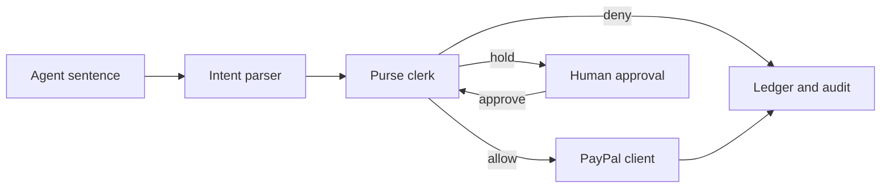

# Architecture

AgentPurse is a local-first Next.js app. Judges and developers run it with `PAYPAL_MODE=mock` and `AI_MODE=mock`. No PayPal, Supabase, Groq, or Gemini account is required.

The parser proposes a merchant, an amount, and a category. The clerk disposes. PayPal captures only after the clerk says allow, or after a human approves a hold and the clerk re-checks the caps.

## Decisions the model is not allowed to make

- Whether a payment is permitted
- Whether a cap, envelope, denylist, or balance check is waived
- The wording of the official reason (the explainer is a template over the rule that fired)

A live model, when configured, only fills the intent struct. The server then requires:

- the amount in cents to match a number written in the sentence
- the category to be one of `groceries`, `travel`, `software`, `electronics`
- the merchant string to be either a known merchant or a phrase the sentence actually contains

If those checks fail, the request is `needs_clarification`, not a payment.

## Modes

| Variable | Default | Effect |
| --- | --- | --- |
| `PAYPAL_MODE` | `mock` | In-process Orders v2 client stored in SQLite |
| `PAYPAL_MODE` | `live` | `api-m.sandbox.paypal.com` or `PAYPAL_API_BASE` |
| `AI_MODE` | `mock` | Deterministic parser, no network |
| `AI_MODE` | `live` | Groq or Gemini, then the same validators |
| `AGENTPURSE_DB` | `data/agentpurse.db` | SQLite file |
| `AGENTPURSE_AUTO_SEED` | on | Seed Maya's purse when the file has no purses |

`PAYPAL_MODE=live` without `PAYPAL_CLIENT_ID` and `PAYPAL_CLIENT_SECRET` throws before any charge. The demo path never sets it.

## Data

One SQLite file is the system of record for the demo. `src/db/schema.ts` creates it on open. `supabase/migrations/0001_agentpurse.sql` is the same model in Postgres for a later Supabase project. The running app does not call Supabase, so a missing project does not block the demo.

Tables:

- `purses` — owner, balance, per-payment cap, daily cap, approval threshold
- `envelopes` — category budget and period (`daily`, `weekly`, `monthly`)
- `agents` — who may spend, and which categories
- `merchants` — display name, category, trusted, blocked
- `spend_requests` — the sentence, the parsed intent, the decision, the status
- `approvals` — human hold decisions
- `paypal_orders` — local mirror of every mock or live order
- `audit_events` — one row per clerk or PayPal transition

Envelope spend is not stored. It is the sum of `captured` requests for that envelope inside the current period. A refund sets the request to `refunded`, so the envelope and the balance both come back. Periods are UTC: calendar day, ISO week starting Monday, calendar month.

## PayPal

`PayPalClient` matches the sandbox calls a live integration makes:

1. `createOrder` — `POST /v2/checkout/orders` with `intent: CAPTURE`
2. `approveOrder` — buyer approval. In mock mode this is an explicit step. In live mode the caller completes approval in the PayPal checkout URL the order returns.
3. `captureOrder` — `POST /v2/checkout/orders/{id}/capture`
4. `refundCapture` — `POST /v2/payments/captures/{id}/refund`
5. `getOrder` — `GET /v2/checkout/orders/{id}`

Two product flows share that client.

**Top-up.** The owner funds the purse. Mock mode shows Created, then Approved, then Captured. Capture increases `purses.balance_cents`.

**Agent spend.** After an allow (or an approval that still passes the caps), the purse pays the merchant: create, approve, and capture. Capture decreases the balance. The PayPal order id is stored on the spend request.

Refunds are full-amount only in this version.

## Clerk

`evaluateSpend` is pure. Order of rules:

1. Incomplete intent (no amount, no merchant, or unknown category) → `needs_clarification`
2. Paused agent, or agent from another purse → `deny`
3. Non-positive amount or wrong currency → `deny`
4. Blocked merchant → `deny`
5. Category the agent is not allowed to spend → `deny`
6. No envelope for that category → `deny`
7. Over the per-payment cap → `deny`
8. Over the envelope remaining in this period → `deny`
9. Over the purse daily cap → `deny`
10. Over the funded balance → `deny`
11. Untrusted merchant, or amount at or above the approval threshold → `needs_approval`
12. Otherwise → `allow`

Every deny and every hold lists all matching reasons, not only the first. Approval re-runs rules 1–10 before capture, so a held payment cannot sneak past a cap that filled while it waited.

## HTTP

Route handlers in `app/api` parse JSON and call `src/server`. They do not contain policy or PayPal logic.

| Method | Path | Action |
| --- | --- | --- |
| GET | `/api/health` | Mode flags, no secrets |
| GET | `/api/purses` | List purses |
| GET | `/api/purses/:id` | Purse, envelopes, agents, holds, ledger |
| POST | `/api/purses/:id/topups` | Create a top-up order |
| POST | `/api/paypal/orders/:id/approve` | Buyer approval step |
| POST | `/api/paypal/orders/:id/capture` | Capture a top-up and credit the purse |
| POST | `/api/agents/:id/spend` | Parse, clerk, maybe capture |
| POST | `/api/spends/:id/approve` | Human approves a hold |
| POST | `/api/spends/:id/deny` | Human denies a hold |
| POST | `/api/spends/:id/refund` | Refund a capture |

## Dashboard

`/` explains the product and lists purses. `/purses/[id]` is the working checkbook: balance, envelopes, a sentence box per agent, the hold queue, and the ledger. Forms are small client components. The page itself is a server component that reads SQLite.

## What is intentionally out of scope

- Partial refunds, multi-currency purses, and recurring billing
- A hosted Supabase connection in the default process
- Letting the model edit caps, merchants, or decisions
