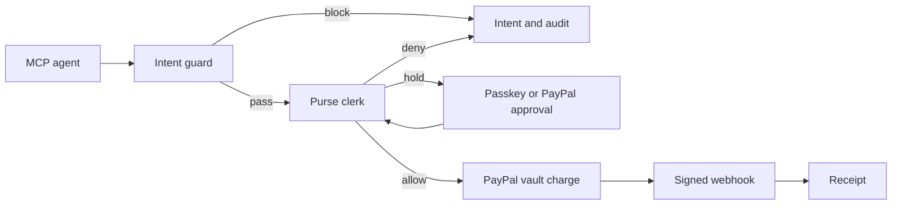

# Architecture

AgentPurse is the purse an AI agent spends from. The payer links PayPal once. Each agent has its own allowance, API key, and policy. A purchase is a merchant-initiated PayPal charge from that vaulted wallet to the merchant. AgentPurse does not hold the money.

Judges run `PAYPAL_MODE=mock` and `AI_MODE=mock` with no accounts. Set `DATABASE_URL` to a Supabase Postgres URL when you want the hosted database. Unset, the app uses SQLite.

## Money

An allowance is a ledger cap on one agent. Raising it does not call PayPal. Spent amount is the sum of capture receipts minus refund receipts.

A charge uses Orders v2:

- `payment_source.paypal.vault_id` from Payment Method Tokens v3
- `stored_credential.payment_initiator = MERCHANT`
- `stored_credential.usage = SUBSEQUENT`
- `stored_credential.usage_pattern = UNSCHEDULED_POSTPAID`
- `purchase_units[0].payee.email_address` is the merchant's sandbox business account
- `purchase_units[0].custom_id` is the intent id

The vault itself is created with no purchase: setup token, payer approval, payment token. Revoke calls `DELETE /v3/vault/payment-tokens/{id}`.

Above the approval line, nothing is captured until a WebAuthn assertion succeeds, or the payer approves a customer-present PayPal order (the fallback link).

## Decisions the model is not allowed to make

- Whether a payment is permitted
- Whether a cap, allowance, denylist, pause, or panic is waived
- Whether a page that disagrees with the user's task is safe
- The wording of the official reason

The model may propose an intent or a policy JSON document. Zod checks the policy. Amounts in an intent must appear in the sentence. Catalog merchants keep their category. The guard and the clerk run after that, in code.

## Intent guard

Inputs are the user's original task, the proposed merchant and amount, and any page text the agent was reading. The guard extracts hidden instructions (for example "buy 5 gift cards") and blocks when the proposal is not the task. A live model may also flag a block. It cannot clear a block the deterministic signals already raised.

## Clerk

`evaluateSpend` is pure. Order:

1. Owner panic freeze
2. Paused or revoked agent
3. Incomplete intent
4. Non-positive amount or wrong currency
5. Blocked merchant
6. Category the agent cannot spend
7. Over the per-payment cap
8. Over the remaining allowance
9. Over the daily cap
10. No vaulted PayPal wallet
11. Untrusted merchant, or amount at or above the approval line
12. Otherwise allow

Approval re-runs the deny rules before capture.

## MCP

`src/mcp` implements tools `search_merchants`, `get_quote`, `request_purchase`, `get_budget`, and `list_receipts`. Stdio is `npm run mcp` and reads `AGENTPURSE_API_KEY`. `POST /mcp` is streamable HTTP (protocol `2025-11-25`): JSON-RPC in, JSON or an accepted notification response out, bearer API key or OAuth access token, Origin rejected when it is present and not allowed.

OAuth is authorization code with PKCE. Metadata is at `/.well-known/oauth-protected-resource` and `/.well-known/oauth-authorization-server`.

## Databases

One SQL dialect, two drivers. `?` placeholders are rewritten to `$1` for Postgres. Booleans are integers. Timestamps are ISO-8601 text. `supabase/migrations` is what a Supabase project applies. Tests run the Postgres statements on PGlite and the default suite on SQLite.

## Modes

| Variable | Default | Effect |
| --- | --- | --- |
| `PAYPAL_MODE` | `mock` | Vault, orders, and webhooks in process |
| `PAYPAL_MODE` | `live` | `api-m.sandbox.paypal.com` |
| `AI_MODE` | `mock` | Local parser, compiler, and guard |
| `DATABASE_URL` | unset | SQLite at `data/agentpurse.db` |
| `AGENTPURSE_AUTO_SEED` | on | Seed Maya when there is no owner |
